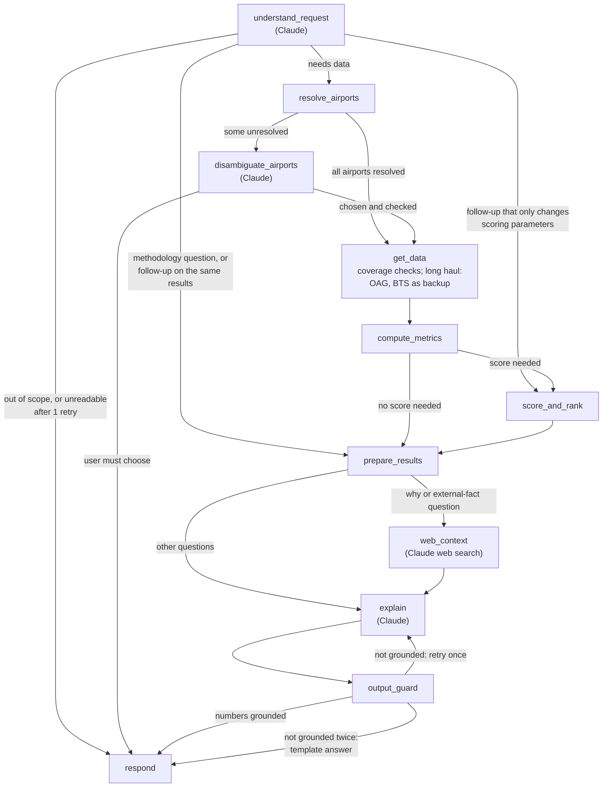

# Airport Investment Intelligence Agent — Architecture

> Status: **implemented and tested offline.** The newest answer modes have not yet been checked against the live model (see PLAN.md). Items not built are marked *planned*. Companion file: [PLAN.md](PLAN.md) (build order, tests, status).
> Language: Python 3.12 · Orchestration: LangGraph · LLM: **Claude Haiku 5.5** via the Anthropic API (configurable; Opus 5.5 or OpenRouter as options) · Live data: OAG API · Public data: BTS (US DOT) and the FAA Terminal Area Forecast.

**How to read this document**

| Section | Answers |
|---|---|
| 1. Goal and scope | What the agent is for, and what it refuses |
| 2. What the data taught us | Facts from the provided files that shaped the design |
| 3. Architecture at a glance | The main parts and how they connect |
| 4. The LangGraph agent | The graph, its routing rules, its state, and every node |
| 5. Data sources and tools | Where data comes from, and the deterministic functions |
| 6. Scoring methodology | How airports are ranked, and every number we chose |
| 7. Where AI is used | The four Claude calls, and why each one uses that model |
| 8. Guard-rails | All protections in one table |
| 9. Chat interface | The UI |
| 10. Key trade-offs | Each main decision and the alternative we rejected |
| 11. Repository layout | Where each file will live |

---

## 1. Goal and scope

**Goal.** Help analysts at a US airport-modernization investor find airports where a renovation would be **most profitable because of the extra flight and passenger capacity it unlocks**: demand is growing, and the airport is already too constrained to serve it.

**In scope**
- US commercial airports (50 states + territories that report to BTS).
- Ranking, comparison, single metrics and "why" questions, with follow-ups in the same conversation.
- A deterministic, documented **Renovation Profitability Score (RPS)** (section 6).
- Answer modes: conceptual explanations (no tools), research with sourced web facts, computed analysis (deterministic tools), methodology, explanation of earlier results, and out-of-scope replies.

**Out of scope (the agent says so)**
- Non-US airports as ranking or screening targets (they can appear as destinations).
- Financial projections (IRR, capex, concession revenue, cash flows) and investment recommendations. The agent explains IRR and revenue models conceptually and reports published budgets with their sources. The score is a **screening index, not investment advice and not a profitability measure**.
- Facts the agent's data doesn't hold (runway geometry, gate counts, project budgets). These are answered only from web sources, which are cited and dated, and **never enter the score**.

**Example questions the design must answer**

| Question | Request type | Answer built from |
|---|---|---|
| Which airports in New England are strong candidates for terminal expansion? | `rank` over a region | RPS ranking + forecast growth + constraint drivers |
| Compare LA and Santa Ana airport congestion levels. | `compare` | Constraint `C` and its four signals |
| What is the percentage of long haul flights out of Anchorage airport? | `metric_lookup` | Long-haul share |
| What is the unmet flight demand in SFO airport and why? | `explain_why` | FAA forecast extra demand + constraint drivers |

---

## 2. What the provided data taught us (design inputs)

The provided files were used to **find out which measures are possible, and to test the scoring method**. Live answers use APIs and public data (section 5).

| File | Grain | Coverage | Used for |
|---|---|---|---|
| `T_ONTIME_REPORTING_MM_YY.csv` × 12 | One row per domestic flight | Aug 2025 – Jul 2026, 7.04M flights, 359 origin airports | Hourly flight counts, taxi-out and taxi-in times, delays, distance, block time (scheduled gate-to-gate time) |
| `AFF-T100_Segment_Summary_By_Origin_Airport_*.csv` | Airport × month | **Jan 2014 – Jul 2026** (despite the file name), 2,104 airports | Passengers, seats, load factor, departures, domestic vs international |
| `L_CANCELLATION.csv` | Lookup | A Carrier, B Weather, C NAS, D Security | Labels |

**What the data showed** (full analysis: [analysis/FINDINGS_constraint_weights.md](analysis/FINDINGS_constraint_weights.md))
1. **Definitions change answers.** Anchorage's long-haul share is 4.9% by distance (≥ 3,000 mi), 12.0% by block time (≥ 6 h), and 22% with a 2,400-mile cut-off. Every answer must state its definition.
2. **The on-time files are domestic only** (reporting airlines only). International flights are missing there, so "all flights" questions need OAG.
3. **Raw delay and taxi numbers mix congestion with other things.** Taxi time includes airfield size; delays include airline and weather problems; NAS delay is often caused at the *destination*. Comparing busy and quiet hours at the same airport isolates congestion (section 6.3).
4. **Data rules:** ratios are sum over sum; year-over-year comparisons use the same months; airports are joined by numeric `AIRPORT_ID`, because codes can change; an empty delay-cause field means "not delayed", not "unknown".
5. **Ambiguous names are real:** "LA" (LAX / LGB / BUR / ONT / SNA), "Portland" (PWM / PDX), "New York" (JFK / LGA / EWR).
6. **Planes are rarely more than 85% full in a month** (zero months for the median airport), so a "turned-away passengers" count would depend on a guessed threshold (section 6.2).

---

## 3. Architecture at a glance

```
┌────────────────┐   ┌─────────────────────────── LangGraph agent (11 nodes) ───────────────────────────┐
│ Chat UI        │   │  Claude (LLM) nodes: understand_request · disambiguate_airports ·                │
│ (Streamlit,    │◄─►│                      web_context · explain                                       │
│ optional voice)│   │  Code nodes: resolve_airports · get_data · compute_metrics · score_and_rank ·    │
└────────────────┘   │              prepare_results · output_guard · respond                            │
                     │  Checkpointer (SQLite) = conversation memory for follow-ups                      │
                     └──────────────┬───────────────────────────────────────────────────────────────────┘
                                    │ deterministic tools (pure Python, unit-tested)
       ┌──────────────────┬─────────┼──────────────────┬───────────────────┬─────────────────────┐
       ▼                  ▼         ▼                  ▼                   ▼                     ▼
  airport resolver    OAG client  public data store  metrics / scoring   output guard        web search
  (reference table,   (schedules, (BTS T-100, BTS    (signals, C, RPS,   (number check,      (Claude server
   aliases, regions)   status)     on-time, FAA TAF)  ranges)             template answer)    tool; "why" only)
                         │
                    disk cache + call budget + audit log
```

**Principle: Claude decides *what* is being asked and *how to say* the answer; code computes every number from the data. Web sources supply only the external facts they state, with their source and date.**

---

## 4. The LangGraph agent

### 4.1 The graph



**A normal turn, in words:** Claude reads the question → code finds the airports (Claude helps only if a name is ambiguous) → code gets the data → code computes the metrics and, if needed, the score → code collects the facts → for "why" questions and external facts, Claude adds web context with its sources → Claude writes the answer → code checks every number → the answer is sent.

**The graph has no loops** except one retry of `explain`. Data problems never loop: the public data is prepared in advance, and for long haul, if OAG fails or the day doesn't fit the call budget, `get_data` uses BTS (domestic only) and the answer says so.

### 4.2 Routing rules (decided by code, not by Claude)

After each branching node, a routing function in `routing.py` picks the next node by checking facts in the state. **Claude only parses the message; it never picks the route.**

| After | Go to | When (checked in code) | User examples |
|---|---|---|---|
| `understand_request` | `respond` | `intent = out_of_scope` (section 1), or Claude's output failed the schema twice. The reply is fixed text from config | "What's the IRR of a new terminal?" |
| | `prepare_results` | `intent = conceptual` or `methodology` (no airport, no data, no search), or the airports, metrics, period and scoring parameters are **all the same** as in `context` from an earlier turn | "How do you score?", "Why is the first one first?", "Show it as a table" |
| | `score_and_rank` | Same airports, metrics and period as in `context`, but **scoring parameters changed** | "Use a 10-year horizon", "Weight the gate signal more" |
| | `resolve_airports` | Anything else (the normal path) | "Rank New England airports", "What about Hartford?" |
| `resolve_airports` | `get_data` | Every airport reference is resolved | |
| | `disambiguate_airports` | At least one reference is ambiguous or not found | "LA", "Portland" |
| `disambiguate_airports` | `get_data` | Claude chose a candidate, and code confirmed it is one of the candidates | |
| | `respond` | The user must choose. **Code** writes the question from the candidate list, so no airport can be added or dropped | |
| `compute_metrics` | `score_and_rank` | The request type needs RPS (rank, explain_why) | |
| | `prepare_results` | It doesn't (compare, metric_lookup) | |
| `prepare_results` | `web_context` | `intent = research` (sourced web facts), `intent = explain_why` without stored results (background; a "why" about a stored ranking is answered from its inputs, with no search), **or** the facts list data the tools couldn't provide (`data_gaps`: a missing metric) → web lookup for exactly that gap | "…and why?", "what is the budget of the new terminal?", "how many gates does X have?" |
| | `explain` | Every other request | |
| `output_guard` | `respond` | Every number in the draft matches the facts | |
| | `explain` | First failure: retry once, with the list of problems | |
| | `respond` | Second failure: send the template answer built from the facts | |

**Source priority:** for computed answers, the tools (BTS, FAA forecast, OAG). **Web search** serves three purposes: external facts the user asks for (research answers), background for "why" questions, and gaps the tools cannot fill. Its results carry their sources and dates, never enter scores or rankings, and are reported as web sources, not as the agent's own data.

**References to the stored ranking (code, `resolve_ranked_positions`, applied right after the parse):** "the top-ranked airport", "the first one", "the second" are sent by Claude as positions (`ranked_positions`). Code turns them into airport codes from the latest stored ranking, in rank order, before any lookup or web search. A generic phrase such as "the top-ranked airport" is dropped from the airport mentions, so it never reaches disambiguation. If there is no stored ranking, or the position is outside it, the agent asks the user and searches nothing. Explaining an existing score uses the stored inputs and runs no web search.

**Scope rules (code, applied to Claude's parse in `normalize_request`):**
- **The whole country is a scope.** "US", "USA", "America", "nationwide"… (list in `regions.yaml`) mean every US airport with flight data.
- **A ranking with no place named covers the whole country.**
- **Region names are matched without generic words** ("division", "region", "states"…), so "Pacific division" = "Pacific".
- **A metric asked for a whole scope is a ranking by that metric** ("biggest airport in the US" = rank by passengers, top 1).
- **"top N" in the message sets how many airports to show** if Claude left it empty.
- **Rankings can use any one measure** (`rank_by`: RPS by default, constraint, passengers, growth, a single signal, delays…) in either direction (`order`). Small scopes list every airport; large ones show the top 10 unless the user asks for a number. The measured range is computed only for the airports shown.
- **Follow-ups inherit what the user didn't change** (scope, measure, horizon); a new question starts from the defaults.

Rules that keep routing safe:
- **Reuse only when everything matches.** If anything differs, or `context` has no results, the request takes the normal path. A wrong reuse would answer with stale data; an unnecessary fetch only costs a little time.
- **Mixed requests aren't out of scope.** In "rank the New England airports and give me the IRR", the ranking continues; the IRR part is stored in `request.out_of_scope_parts`, and the answer says it was skipped and why.
- **When unsure, continue.** If Claude can't tell whether a request is in scope, it chooses the in-scope type. A later node can still ask or report a gap; a wrong "out of scope" would refuse a valid question.
- **A methodology answer contains no airport numbers.** Its facts come only from config.
- After any route, `respond` saves `context`, so the next message can build on this turn.

### 4.3 State (`AgentState`)

A Python `TypedDict` with Pydantic sub-models. **Each node writes only the keys listed for it** (checked by a test).

| Key | Written by | What it holds |
|---|---|---|
| `messages` | `respond` (LangGraph appends) | Chat history |
| `request` | `understand_request` | Request type (`intent`), airport mentions, region, metrics, period, top N, scoring parameters (section 6.8), `out_of_scope_parts` |
| `airport_refs` | `resolve_airports`, `disambiguate_airports` | Per mention: the text, status (`resolved / ambiguous / not_found`), candidates, the chosen airport, how it was chosen |
| `clarification` | `disambiguate_airports` | The mention that needs the user, with its candidates (or null) |
| `raw_data` | `get_data` | Data per source, with where it came from (endpoint, time, cache hit, which attempt served it) |
| `data_quality` | `get_data` | Per airport × input: `ok` or `missing` with the reason, plus caveats (section 6.4) |
| `metrics` | `compute_metrics` | Per airport and metric: value, unit, period, source, number of flights, reason if null |
| `scores` | `score_and_rank` | Per airport: RPS, rank, `growth_share`, `ΔD`, `C` and its four signals, measured range, caveats, FAA hub size |
| `facts` | `prepare_results` | The **only** numbers Claude may quote, plus assumptions, scope notes and gaps |
| `web_context` | `web_context` | Short notes with their source URLs, titles and dates, plus a status: `results`, `no_reliable_result` or `failed` |
| `draft_answer` | `explain` | The answer before checking |
| `answer` | `output_guard` | The checked answer (or the template answer) |
| `context` | `respond` | The last request, its `metrics` and `scores`, and the scoring parameters, for follow-ups. A turn that only discusses or compares airports (any intent except `rank`, when earlier scores exist) keeps the earlier context unchanged, so the ranking population and display count survive it |
| `counters` | every node that calls Claude or an API | Claude calls, API calls, `explain` retries |
| `errors` | any node | Non-fatal problems, shown in the UI's trace panel |

### 4.4 The nodes

**D** = deterministic code · **L** = Claude call.

**Spec rule:** this table states general rules only, never example questions, airports or answers. Examples in a spec push the code toward special cases that pass those examples. Concrete cases live only in the tests (PLAN.md), including held-out cases that appear in no document. **The code contains no airport-specific logic**; anything about a specific airport or city lives in config (`aliases.yaml`, `regions.yaml`).

| # | Node | Type | What it does | Reads → writes | Guard-rails | Tests must prove |
|---|---|---|---|---|---|---|
| 1 | `understand_request` | L | Turns the message + conversation into `request` | messages, context → request, counters | Structured output (Pydantic); request type and metrics are **enums** from the KPI catalog; outputs no numbers except ones the user typed; 1 retry if the output fails the schema | Every request type is reachable; follow-up references resolve to `context`; invalid output never leaves the node |
| 2 | `resolve_airports` | D | Turns mentions into airports, and region names into airport lists | request → airport_refs | Only airports in the reference table; codes never invented; match order: exact code → alias → exact name → city → fuzzy (aliases first, so a known ambiguous name is never silently resolved); a weak fuzzy match counts as *ambiguous*; regions come from config only | Each match type gives the right status; no output outside the reference table; same result on every run |
| 3 | `disambiguate_airports` | L | For each unresolved mention: picks a candidate from context, or says the user must choose | airport_refs, messages → airport_refs, clarification | Answer must be a candidate ID or `ask_user`, checked in code; `not_found` always → `ask_user`; at most 1 clarification per turn | A non-candidate answer is rejected; the clarification lists exactly the candidates |
| 4 | `get_data` | D | Checks that each airport has complete public data (12 months of T-100) and, for a long-haul question, fetches the airport's OAG schedule for one day; if OAG fails or the day doesn't fit the call budget, records the BTS fallback and why | request, airport_refs → raw_data, data_quality, counters | Cache first; call budget checked before paging; retries on 429/5xx as the API says (`Retry-After`); the OAG key goes only to the OAG host and is never logged; errors become a fallback with a reason, never a crash | Each OAG failure type leads to the BTS fallback with a reason; the budget is respected; cached days make no calls; the key never appears in logs or errors |
| 5 | `compute_metrics` | D | Calculates every metric and the 4 constraint signals | raw_data, data_quality → metrics | Missing → null + reason, never 0; ratios are sum over sum; means weighted by flights; codeshare copies dropped; units attached | Every formula matches a hand-computed value on small synthetic data; null in → null out |
| 6 | `score_and_rank` | D | Runs the 4-step RPS calculation (section 6.2), ranks, adds the measured range, caveats and FAA hub size | metrics, request (or context) → scores | Weights of `C` non-negative, rescaled to sum to 1; horizon 5, 10 or 20 years; no FAA forecast → fallback growth + caveat; load factor missing → "not scored" with the reason; no airport removed for size or caveats | RPS matches a hand-computed value; `C = 0` gives RPS 0; RPS never falls when growth or `C` rises; same numbers in rank, compare and explain |
| 7 | `prepare_results` | D | Builds `facts`: the tables, drivers, assumptions, gaps and caveats for this question. For methodology questions, from config; for same-results follow-ups, from `context` | metrics, scores, context, request → facts | Every number is rounded once, here; assumption and method text comes from config, so it can't drift from the code | Every number in `facts` traces back to `metrics`, `scores` or config |
| 8 | `web_context` | L (web search) | Two modes. **Background** for "why" and research questions. **Gap lookup** when the tools lacked the data (`data_gaps`): the LLM searches the web for exactly what's missing | request, facts → web_context | At most 3–5 results; every note carries its source URLs and dates; the answer labels web facts by provenance (reported fact, source claim, interpretation), not all as unverified; never used in metrics, scores or rankings; fetched text is data, never instructions; a failed search is reported as failed | Runs only for "why", research or data-gap questions; rankings and metrics the tools have never trigger it; injected instructions change nothing |
| 9 | `explain` | L | Writes the analyst's answer from `facts` (plus labeled web context) | facts, web_context, request, messages → draft_answer | Numbers only from `facts` (computed answers) or from cited web sources (research answers); initial computed answers include an *Assumptions & uncertainty* section and the screening sentence; a focused follow-up does not repeat them but states each essential caveat (`facts.essential_caveats`); source and date cited; no investment-advice wording | Drafts pass `output_guard` on the eval set |
| 10 | `output_guard` | D | Checks the draft; after a second failure, builds the template answer from `facts` | draft_answer, facts → answer | Checks depend on the answer mode. Computed: every number matches a fact (within rounding) and each airport's numbers match its own row. Conceptual: airport-related numbers come from facts or the question. Research: numbers appear in the retrieved text or source metadata (with or without a web heading), and cited URLs were retrieved; claims about a search must match what ran. Computed: a comparative sentence ("A is below B") and a superlative ("A has the highest…") are checked against the airport rows shown; a contradiction is rejected. All modes: every airport code is in the resolved set. The assumptions section and screening sentence are required only for initial computed answers. Every computed answer must state its essential caveats (`facts.essential_caveats`: fallback growth, RPS 0, flagged airports, the constraint-only range, a changed horizon, custom weights). The fallback template follows the same rules | Invented numbers, extra airports and missing sections are rejected; the template answer renders for any facts |
| 11 | `respond` | D | Sends the final message (answer, clarification question or scope reply), saves `context`, writes one audit line (`data/cache/audit.jsonl`) | answer or clarification → messages, context | — | The next turn can use what was saved; after a clarification, the user's reply resolves the airport |

**Graph-wide limits:** LangGraph `recursion_limit` (25 steps) and at most 1 `explain` retry. The graph itself bounds Claude calls to at most 6 per turn (`understand_request` 2, `disambiguate_airports` 1, `web_context` 1, `explain` 2). Each API call has a timeout from its SDK or documentation.

---

## 5. Data sources and tools

### 5.1 Sources

| Source | Access | Used for | Notes |
|---|---|---|---|
| **OAG API** (live) | REST, `Subscription-Key` header | **Long-haul share only**, for the airport a question names: all flights and passenger flights, domestic + international | Free tier: 10 records per call (one airport-day = 49–177 calls), no seats, no actual times ([docs/oag_notes.md](docs/oag_notes.md)). Operating flights only. If an airport-day exceeds the call budget, fall back to BTS (domestic only) and say so |
| **FAA Terminal Area Forecast (TAF)** (public) | Yearly XLSX download from faa.gov; no API found | Passenger forecast per airport, years ahead → `growth_share` (RPS step 1) | The FAA's official forecast; fiscal years (Oct–Sep); edition stated in every answer |
| **BTS T-100** (public) | **API:** data.bts.gov (Socrata, dataset `r495-tyji`, no key), pulled by the data build; the downloaded file is the fallback | Passengers and seats → load factor; international share (information) | Same dataset as the provided file (all 134,619 rows verified identical). OAG has no passenger counts, so passengers come from here |
| **BTS On-Time** (public) | Public download | **Main source for the 3 hourly constraint signals** (peak saturation, cleaned taxi-out, cleaned taxi-in); backup for long haul (domestic only); delay figures as information | Domestic only |
| **LLM web search** | Anthropic web search tool (version by model, §7.4) | **Research questions** (external facts with sources); background for "why" questions; **facts the tools don't hold** (gates, terminals, runways, projects…) and **metrics the tools couldn't provide** | Reported with their source and date, *not from the agent's data*; **never used in scores or rankings** |
| **Airport reference** | BTS airport IDs + the FAA's airport list (in the TAF download) | Official name, city, state, location and **FAA hub size** → regions, aliases, labels | Joined on the FAA id, which equals the IATA code except for a few airports listed and verified in `config/faa_ids.yaml` |

> **API vs public files (PLAN.md decision D1):** passenger data (T-100) comes from the **data.bts.gov API**. OAG provides long haul live. The flight-level on-time data and the FAA forecast have no API we found, so they come from official public downloads, refreshed on a schedule and labeled as such.

### 5.2 Deterministic tools

All pure Python with typed inputs and outputs.

| Module (`src/airport_agent/tools/`) | What it does | Used by |
|---|---|---|
| `resolve.py` | `resolve_one`: exact code → alias → exact name → city → fuzzy; `expand_region`: region → airports | `resolve_airports` |
| `public_store.py` | Reads the processed BTS and TAF files (Parquet, via pandas); the default 12-month period | most nodes |
| `checks.py` | The hard checks of section 6.4 | `metrics.py` |
| `metrics.py` | One function per metric and signal, incl. `busy_minus_quiet` and `percentile_rank` | `compute_metrics` |
| `oag_client.py` | OAG calls: paging, cache, budget, retries, codeshare filtering (long haul only) | `get_data` |
| `scoring.py` | `growth`, `constraint`, `constraint_range`, `score_airport`, `rank` | `score_and_rank` |
| `facts.py` | The facts bundle for each request type | `prepare_results` |
| `output_guard.py` | `check` (number grounding) and `template` (fixed-format answer) | `output_guard` |

---

## 6. Scoring methodology — Renovation Profitability Score (RPS)

### 6.1 What the score means
**The highest RPS = the airport where a renovation would be most profitable, because the added flight and passenger capacity would actually be used.**

A renovation makes money only when **both** are true:
1. **There is demand to fill new capacity.** Demand is growing, so new gates and flights would be used.
2. **The airport is capacity-constrained today**: planes are full, peaks hit the ceiling, aircraft queue for the runway or wait for gates. If an airport has spare capacity, airlines can add flights without a renovation, so expanding it adds little.

So the score combines **how much the airport is expected to grow, relative to its size** (the FAA's forecast) with **how constrained it is today** (`C`).

**What RPS is not.** It is a screening index. It is not a profitability or ROI measure, not an IRR, and not a measure of unmet demand: FAA forecast growth is planned growth, not passengers turned away. The taxi-in signal is a busy-minus-quiet difference, which is indirect evidence of gate waiting. Taxi-out queuing does not prove that an expansion would fix the bottleneck. Peak throughput is not certified capacity. The 30-flight minimum is a rule of thumb.

**Why relative to size, not absolute passengers:** in absolute terms a big airport almost always wins just because it's big. But a bigger airport's renovation also costs more: FAA terminal planning guidance sizes terminals from the number of passengers they must handle at peak (AC 150/5360-13A, *Airport Terminal Planning*), so the cost of adding capacity grows with traffic. Growth relative to size is therefore the closer screening measure. It is **not a measure of return on investment**, because the agent has no project cost or revenue data. Forecast extra passengers in absolute terms are still shown for every airport.

### 6.2 The calculation (four steps, parameters in `config/scoring.yaml`)

| Step | What | Formula | Source |
|---|---|---|---|
| 1. Demand growth | Expected passenger growth over the horizon, as a share of today: `growth_share` | `growth_share = TAF(base year + H) / TAF(base year) − 1`. TAF = the FAA's forecast of enplanements (boarding passengers) for the airport; base year = the fiscal year our data window ends in (FY2026), using the FAA's value for that year, so years already past don't count as future growth. **If the FAA has no forecast for the airport:** fallback growth of 2% a year (config `fallback_growth_per_year`), so `growth_share = (1 + 0.02)^H − 1`, with a caveat. | **FAA TAF**; fallback 2%/year |
| 2. Future demand | Forecast extra passengers at horizon `H` (shown as information) | `ΔD = passengers_now × max(0, growth_share)`. Applying the TAF *ratio* to our measured passengers makes small definition differences cancel out | T-100, FAA TAF |
| 3. Capacity constraint | `C` from 0 to 1: how constrained the airport is **compared with other US airports** | Average of the 4 percentile-ranked signals (section 6.3) | T-100, BTS on-time |
| 4. Score and ranking | Growth relative to size, weighted by how constrained the airport is | `RPS = 100 × max(0, growth_share) × C`. **Ranking = airports sorted by RPS, highest first.** No conversion, no cap | — |

**What an RPS value means:** it's an **index**, not a passenger count. `C` ranks how constrained an airport is; it isn't a measured share of demand that would be lost. So RPS 12 doesn't mean "12% more passengers"; it means a stronger combination of forecast growth and constraint than an airport at 8. We don't turn it into "passengers unlocked", because that would need an assumption nobody can check.

**Why a product, not a weighted sum:** a sum would give a high score to a fast-growing airport with lots of spare capacity, where renovating adds almost nothing. A product is zero if either part is zero, which is how the investment works.

**Worked example** (made-up airports, horizon 5 years):

| Airport | Passengers now | Forecast growth over 5 years (`growth_share`) | Forecast extra passengers `ΔD` (information) | Constraint `C` | **RPS** | Rank |
|---|---|---|---|---|---|---|
| Small, fast-growing, very tight | 2M | 33.8% | 0.68M | 0.9 | **30.4** | **1** |
| Big, growing, tight | 20M | 15.9% | 3.19M | 0.7 | **11.2** | 2 |
| Biggest, growing, plenty of room | 30M | 21.7% | 6.50M | 0.1 | **2.2** | 3 |

The biggest airport expects the most extra passengers but has spare capacity, so it ranks last. The small airport expects the fewest, but the most relative to its size, and it is very constrained, so it ranks first.

**Zero RPS → listed, not ranked.** If `growth_share ≤ 0` or `C = 0`, RPS is 0. Such an airport gets no rank number: it is listed under "Listed, not ranked" with its reason ("FAA forecast shows no growth over the horizon, so RPS is 0", or "constraint C is 0, so RPS is 0"). A missing FAA forecast is a different case: the fallback growth of 2% a year is used and the airport is ranked, with a caveat.

#### Design note: no "passengers turned away today" term
Public data shows only passengers who flew, so turned-away demand can't be counted. Estimating it from load factor needs a "full" threshold, and the result depended almost entirely on that guess (31, 71 or 92 of 105 airports had spill at 85%, 82% or 80%). We don't need a count to rank airports: load factor is already in `C`, so fuller planes still raise the score. Details: [analysis findings, part 5](analysis/FINDINGS_constraint_weights.md).

### 6.3 Capacity constraint `C` (step 3)
`C` = the **average of 4 signals with equal weight (0.25 each)**. The signals have different units (a fraction, minutes), so each is first put on one 0–1 scale by **percentile rank**:

**scaled value = the share of reference airports with a lower value** (ties count half).

- 0.95 means "higher than 95% of US airports"; 0.03 means "higher than only 3%".
- **Reference airports** = all US airports that pass the hard data checks, measured once by `calibrate_signal_scales.py` and stored with the date. There is no passenger minimum. Because the reference is fixed, an airport gets the same value whichever question is asked.
- **Nothing is capped:** airports tie only if their raw values tie. A value beyond every reference airport gets 0 or 1, which is literally true.

| Signal | How it is calculated | What it shows | Source (priority) |
|---|---|---|---|
| **Load factor** | Σ passengers / Σ seats, last 12 months | Demand: planes are full | T-100 |
| **Peak saturation** | Average over days of the busiest hour's departures ÷ the airport's maximum hour | Runway and schedule: the normal daily peak already reaches the most the airport has handled | BTS on-time |
| **Cleaned taxi-out** | Mean taxi-out in busy departure hours − mean taxi-out in quiet departure hours, same airport | Runway queue, without the effect of airfield size | BTS on-time |
| **Cleaned taxi-in** | Mean taxi-in in busy arrival hours − mean taxi-in in quiet arrival hours, same airport | **Gate shortage**: planes wait for a free gate, and gates are what a terminal expansion adds | BTS on-time |

Definitions (all in `scoring.yaml`):
- **Maximum hour** = the airport's 99th-percentile hour, so one-off extreme hours are ignored.
- **Utilization** of an hour = flights in that hour ÷ the maximum hour.
- **Busy hour:** utilization ≥ 0.75. **Quiet hour:** utilization ≤ 0.25.
- Means are weighted by flights.

How this was chosen and checked (105 US airports with ≥ 1M passengers; [analysis findings](analysis/FINDINGS_constraint_weights.md)):
- **Signals:** 13 candidates tested. NAS delay share and gauge-vs-flights had no relation to measured congestion; the delay rate added nothing once taxi times were cleaned; the rest duplicated kept signals (parts 1–3).
- **Weights:** equal and regression weights rank airports almost the same, so the simplest were kept (parts 1–3).
- **Scaling:** percentile rank had the fewest ties and the best match with congestion. The old capped scaling left 21% of values stuck at 0 or 1; min–max let one extreme airport squeeze the rest (part 4).
- **Busy/quiet cut-offs:** safe. Anything from 65/35 to 80/20 ranks airports almost the same (part 6).
- **Maximum hour:** sensitive. With the 95th percentile, 75 of 105 airports move more than 5 places, though 9 of the top 10 stay. **The top of a ranking is stable; middle positions are approximate** (part 6).
- **Validation:** `C` matches measured runway + gate congestion at ρ = 0.79 (90% interval 0.72–0.85). Treat this as an upper bound: the cleaned taxi signals share data with the congestion measure. They're kept mainly because, logically, they measure waiting, not distance.

### 6.4 What every airport's answer contains
- **RPS and rank.** An index with no upper cap.
- **Forecast extra passengers `ΔD`**, so analysts see size as well.
- **Drivers:** `growth_share`, `C` and its four signals (raw value and percentile), international share as information. "Why is X first?" is answered from these exact numbers.
- **Signals measured:** "4 of 4", or e.g. "2 of 4 ⚑" when `C` rests on fewer signals (typically airports too small to have both busy and quiet hours). These airports **stay in their ranked place but are flagged**, and the answer explains the flag next to them (decision: keep and flag, rather than rank separately).
- **FAA hub size:** large / medium / small / nonhub, taken from the FAA's airport list (the official classes by share of US enplanements: ≥ 1%, 0.25–1%, 0.05–0.25%, < 0.05%; 49 U.S.C. 47102). A label only; it never removes an airport.
- **Range** (low / base / high), measured from data:
  - *Growth (planned, not yet built):* how far past FAA forecasts were from what happened, for airports of the same hub size and horizon (older TAF editions vs actual enplanements). Until it is built, no growth range is shown.
  - *Constraint:* `C` recomputed on resampled days (bootstrap), 5th and 95th percentile.

  If the range overlaps the next airport, the answer says "rank not clearly separated".
- **Caveats**, stated as facts (no levels, no counting):

  | Caveat | When |
  |---|---|
  | Constraint signal missing | One of the four signals failed a hard check; `C` is the average of the rest |
  | Fallback growth | The FAA has no forecast for the airport, so growth uses the fallback of 2% a year |
  | Long haul from BTS | OAG failed or the day didn't fit the call budget, so long haul uses BTS (domestic flights only) |
  | Missing block time | Some OAG flights have no usable block time; the distance-based share covers them |

  The data period of every input is always stated, so old data is visible without a threshold.

**Hard checks** (`checks.py`, applied when each metric is computed), which decide whether an input can be used at all:
- **Physically possible values:** load factor between 0 and 1; counts and times not negative. (A *cleaned* taxi signal may be negative, since busy minus quiet can be.)
- **Complete periods:** all 12 months present; year-over-year uses the same months.
- **Enough flights for a mean:** at least 30 flights in each group a mean is taken over (e.g. busy and quiet hours). n ≥ 30 is the standard statistics rule of thumb for when a sample mean behaves normally (central limit theorem).

An input that fails is missing. If load factor is missing, the airport is "not scored", with the reason. A missing FAA forecast doesn't stop scoring: the fallback growth is used, with a caveat.

**Which airports are ranked:** every US airport in the question's scope that passes the hard checks. There is no passenger minimum and no confidence cut-off. The "105 airports with ≥ 1M passengers" in the analysis was only the **test set** for choosing the signals; it doesn't limit the ranking. Airports that can't be scored (load factor missing) or have no growth (`growth_share ≤ 0`) are listed separately with the reason.

### 6.5 How the four example questions are answered

| Question | Answer built from |
|---|---|
| New England terminal expansion candidates | RPS ranking for the region + forecast extra passengers + drivers + range + hub size + caveats |
| LA vs Santa Ana congestion | The four constraint signals and `C` side by side (no RPS needed) |
| Anchorage long-haul share | The long-haul share (6.6), not RPS |
| SFO unmet demand and why | The FAA forecast extra passengers (`ΔD`) are **planned growth, not unmet demand**, and are presented as such. How constrained SFO is (`C`) and which signals drive it. Web context on causes is sourced background. It doesn't claim a count of lost passengers (6.2), and says that demand turned away *today* can't be measured, showing load factor as the closest indicator |

### 6.6 Other measures (answered on request, not in RPS)
- **Long-haul share** = long-haul departures / all departures. Default: block time (scheduled gate-to-gate time) ≥ 6 h, where IATA's long-haul band starts. Alternative: distance ≥ 3,000 mi, the threshold American Airlines uses. The user can set either. Computed from OAG for one schedule day (`oag_reference_date` in config, stated in the answer), so international flights are included; passenger flights are shown separately, because cargo is a large share at some airports. The answer states the definition and shows both numbers.
- Delay rate, cancellation rate and causes, international share, passengers, departures.

### 6.7 Assumptions shown to users
- Horizon 5 years by default, the short-term period in FAA airport master planning (AC 150/5070-6B uses about 5, 10 and 20 years); 10 or 20 can be chosen.
- Growth is the FAA's official forecast. It can be wrong; the answer cites the TAF edition. A measured range of past forecast error is planned, not yet built.
- For an airport the FAA doesn't forecast, growth is a fallback of 2% a year. This number is our choice, not a source; it's marked on every such airport.
- `C` is a relative index, so RPS is an index for ranking, not a passenger forecast.
- Demand turned away today isn't measured (design note in 6.2); full planes count through load factor.
- Gate shortage is measured indirectly (planes waiting for a gate); other terminal data (check-in, security, gate counts) isn't public. A renovation is assumed to relieve the constraint it measures.
- RPS doesn't include construction cost, so it is **not an IRR and not investment advice**.
- Period = the latest 12 months covered by all sources, stated in every answer.

### 6.8 What the user can change in a follow-up
- **Horizon:** 5, 10 or 20 years (the FAA master-planning periods).
- **Long-haul definition:** block time or distance, with the user's own threshold.
- **Weights of the four signals:** any non-negative weights; code rescales them to sum to 1.

Claude reads these into parameters, code checks them against these rules, and RPS is recomputed without fetching data again. The answer shows the parameters used.

### 6.9 Every number we chose (assumptions register)
Every number in the method that isn't measured from data, what it affects, and what supports it. All are in config, so changing one never needs a code change.

**Basis:** *Official / published* = from an official or published source · *Tested* = checked on our data · *Measured* = computed from data each time · *Definition* = follows from what is measured · *Judgment* = a project decision with no source, stated openly.

**Numbers that change the ranking**

| Number | What it does | Basis |
|---|---|---|
| Growth = FAA TAF forecast | Step 1 | **Official:** FAA Terminal Area Forecast |
| Fallback growth 2% a year | Step 1, only for airports with no FAA forecast | **Judgment** (project decision), configurable; every affected airport carries the caveat "fallback growth" |
| Horizon 5 years (10, 20 allowed) | How far ahead growth is counted | **Published:** FAA airport master planning periods (AC 150/5070-6B) |
| Growth relative to size | The ranking measure | **Published:** FAA terminal planning sizes terminals from passenger volume (AC 150/5360-13A) |
| 4 signals, equal weights (0.25) | What `C` measures | **Tested** (findings parts 1–3) |
| Percentile-rank scaling | Puts the signals on one scale | **Tested** (part 4) |
| Busy ≥ 75%, quiet ≤ 25% of the maximum hour | The cleaned taxi signals | **Tested, safe** (part 6) |
| Maximum hour = 99th-percentile hour | Peak saturation and busy/quiet hours | **Tested, sensitive:** middle of the ranking moves; top 10 stable (part 6) |

**Numbers that decide whether an airport can be ranked**

| Number | What it does | Basis |
|---|---|---|
| ≥ 30 flights per group a mean is taken over | Minimum for a usable mean | **Published:** standard statistics rule of thumb (central limit theorem) |
| Load factor 0–1; counts and times ≥ 0 | Rejects impossible values | **Definition** |
| 12 of 12 months; same months for year-over-year | Complete, comparable periods | **Definition** |

**Numbers that only label or present results**

| Number | What it does | Basis |
|---|---|---|
| FAA hub size bands (≥ 1%, 0.25–1%, 0.05–0.25%, < 0.05% of US enplanements) | Size label | **Official:** 49 U.S.C. 47102 |
| Range | Low / high RPS | **Measured:** bootstrap of `C`. The growth range from past forecast error is **planned**, not built |
| Range interval: 5th–95th percentile | Which part of the bootstrap is shown | **Judgment:** a 90% interval, a common convention |
| Long haul: block time ≥ 6 h; distance ≥ 3,000 mi | Long-haul answers | **Published:** IATA long-haul band; American Airlines threshold |
| OAG calls per question | Cost limit | **From the OAG plan:** the subscription's quota (Phase 0 spike) |
| Retries after an API error | Temporary failures | **From the API:** each API's documented retry guidance; the Anthropic SDK default for Claude |
| Graph step limit (25) and one `explain` retry | Stop a turn that has gone wrong | **Definition:** more than a normal turn needs in this graph |
| Bootstrap: 200 resamples, fixed seed | Precision and repeatability of the `C` range | **Computation setting**, not an assumption |

**Removed because nothing could support them:** the 85% "full" threshold (spill); the 1.8× international passenger weight; the numeric data-quality score `q`; the 0.5 / 0.5 growth blend and its −5% / +8% limits; the capped 10th–90th percentile scaling; the "unlocked passengers / flights" count; the High / Medium / Low confidence levels and their thresholds; the 200-flight and 75%-coverage checks; the `C` < 0.3 and 500k flags; the fixed range widths; the input-length and turn-time limits.

---

## 7. Where and how AI (Claude) is used

The model is set in config, not in code: `CLAUDE_MODEL` (current: **`claude-haiku-5-5`**) with `LLM_PROVIDER=anthropic` (direct Anthropic API). Two other options exist and need no code change: `CLAUDE_MODEL=claude-opus-5-5` (the most capable), or `LLM_PROVIDER=openrouter` with `OPENROUTER_MODEL` (any model OpenRouter serves). Each call sets its own **effort** (how much the model thinks before answering); effort is set per call in code and listed in §7.1.

### 7.0 Why Haiku 5.5 is the configured model
- **Evidence so far.** On the scope evaluation run before the answer-mode rewrite, Haiku 5.5 passed 17 of 17 (the reported questions and new phrasings) and 25 of 27 on a second set of unseen phrasings. The answer-mode rewrite has not been evaluated live yet (see PLAN.md).
- **Price (Anthropic pricing page, checked 2026-11-05):** $0.10 input / $0.50 output per million tokens for prompts up to 100,000 tokens; $0.50 / $2.50 for prompts over 100,000 tokens. No claim is made here that it is the cheapest Claude model.
- **The trade-off is stated, not hidden:** Haiku is more likely than Opus to misread unusual follow-ups or to write a weaker explanation. Two protections cover this: the rules in code (scope, routing and the number check) do not depend on the model, and the evaluation is re-run whenever the model changes. Opus 5.5 was not re-run on the same evaluation after the scope fixes, so the comparison is not measured.

### 7.1 Each call, and why this model and setting

**1. `understand_request`: turn the question into a structured request**
- **Job:** fill `request` from the message and the conversation: intent (one of the answer modes in §1), airports, region, metric, ranking measure and direction, how many airports to show, parameters, out-of-scope parts.
- **Why an LLM:** analysts phrase things freely, and follow-ups depend on context. Rules can't cover every phrasing. The unseen-phrasing set was run before the answer-mode rewrite and has to be run again.
- **Why this model:** the most consequential call, since later nodes trust it. A misread shows up in the scope evaluation first (`tests/evals/run_scope_eval.py`).
- **Why effort `low`:** the output is short and locked to a schema, so long thinking adds delay without improving it.
- **Code rules applied afterwards** (`normalize_request`): a whole-scope metric becomes a ranking; a ranking with no place covers the country; "top N" in the text sets how many to show if the model left it empty.
- **How:** structured output with the Pydantic model, so the response always matches the schema.

**2. `disambiguate_airports`: pick a candidate airport, or ask the user**
- **Job:** for an ambiguous mention, choose a candidate from context, or return `ask_user`.
- **Why an LLM:** choosing needs world knowledge plus the conversation, which a lookup table can't weigh.
- **Why this model:** a wrong choice is silent, so the choice is checked in code: the answer must be one of the listed candidates, with high confidence, or the agent asks.
- **Why effort `low`:** a few candidates in, one ID out.
- **How:** structured output; the question to the user is built by code from the candidate list.

**3. `web_context` and `web_lookup`: web search**
- **Job:** `web_context` gives background for "why" questions. `web_lookup` searches for facts the tools could not provide (`data_gaps`) and for research questions.
- **Why an LLM:** it must decide what to search, judge sources and summarize briefly.
- **Why effort `low`:** at most 3–5 searches and a short summary. Results never enter a number or a score.
- **How:** the Anthropic web search tool, version chosen by model (§7.4).
- **Safety:** web pages are data, not instructions; every note carries its source links and date, and the answer states which part comes from web sources.

**4. `explain`: write the answer**
- **Job:** turn `facts` into a clear answer: ranking or comparison, drivers, the flagged airports, *Assumptions & uncertainty*, sources and periods.
- **Why an LLM:** this is what the user reads; it must compare, highlight and explain caveats plainly. A template can only do this stiffly; the template is the fallback.
- **Why this model:** the number check is the guard: every number in the draft must come from `facts`. A draft that fails it is retried once (with the reasons), then the template answer is used, so a weaker writer costs retries, not wrong numbers.
- **Why effort `medium`:** real reasoning (main drivers, fitting caveats), and quality matters most here.
- **How:** streamed to the UI; checked by `output_guard`.

### 7.2 Cost and changing the model
- **Per question:** 2–5 short calls. Web search costs $10 per 1,000 searches on top of token costs (Anthropic web search docs). No per-question cost estimate is stated, because it has not been measured.
- **Changing the model:** one line in `.env` (`CLAUDE_MODEL`). No code change. Check the web search tool version (§7.4) and re-run the scope evaluation (`tests/evals/run_scope_eval.py`) and the live browser test after any change.
- **Prompt caching:** the system prompt and the KPI catalog are in a stable prefix with `cache_control`, reused across calls.

### 7.3 What is *not* AI
Airport lookup, regions, data fetching and fallback, checks and caveats, all metric math, scoring and ranking, rounding, the flags, clarification questions, the grounding check and the template answer. All deterministic code with tests.

### 7.4 Implementation notes
- The official `anthropic` SDK is used inside the LangGraph nodes (`llm/client.py`); calls go to `api.anthropic.com`, with the key from `ANTHROPIC_API_KEY`.
- **Structured answers:** `client.messages.parse` with the Pydantic model, so the output is validated by the SDK.
- **Effort:** set explicitly on every call (`output_config={"effort": ...}`). No thinking budget is set.
- **Web search tool by model:** Haiku 5.5 uses the basic version (`web_search_20250305`). The Anthropic docs (checked 2026-11-05) list `claude-haiku-5-5` as supporting web search, and the filtered version (`web_search_20260209`, dynamic filtering) as documented for Opus, Sonnet and Sonnet 4.6, not for Haiku. `web_search_tool(model)` picks the version from the model name, so a model change keeps working. Not yet run live.
- **Refusals:** the call checks `stop_reason`; a refusal is treated as "no answer", so the fixed reply or the template answer is used.- **API errors** (no credit, a rejected key, rate limit, no connection) are named in plain words and reach the user as a message that says the question is fine, not that it needs rephrasing.
- **OpenRouter (option, `llm/openrouter.py`):** the same five calls through `https://openrouter.ai/api/v1`, with a strict JSON schema built from the Pydantic model, `require_parameters` so only endpoints that support it serve the call, and the web plugin for search. The key is sent only to openrouter.ai and never logged.

---

## 8. Guard-rails summary

| Layer | Guard |
|---|---|
| Input | Scope decided by `understand_request` as a structured request type; no secrets echoed |
| Claude outputs | Pydantic schemas, enums, candidate-only choices, 1 retry, then a fixed reply or the template answer |
| Numbers | Only code computes numbers; `output_guard` rejects any number not in `facts` |
| Data | Null not zero; sum over sum; same months for year-over-year; ≥ 30 flights per mean; physically possible values only; codeshare copies dropped; join by airport ID |
| Tools / APIs | Timeouts; retries per each API's documentation; a failing source is marked down for the turn; call budget; cache; OAG key only to the OAG host; keys only from `.env`, never logged |
| Loops | No data loop; one `explain` retry; graph step limit; at most 6 Claude calls per turn by construction |
| Answer content | Mandatory *Assumptions & uncertainty* section; source and period on every number; "screening signal, not investment advice"; web content shown with its source and date, never as the agent's own data |
| Untrusted content | API and web text treated as data, never as instructions |

---

## 9. Chat interface

- **Streamlit** chat (`st.chat_message`, streamed answer).
- **Side panel:** the score table, each metric with its source, period and caveats, the parameters in use, and a node trace (which nodes ran, cache hits, API calls), so reviewers can see the reasoning.
- One chat session = one LangGraph `thread_id` (SQLite checkpointer), so follow-ups work.
- **Voice (bonus, if time allows):** `st.audio_input` → local speech-to-text (`faster-whisper`) → the same graph.

---

## 10. Key trade-offs

| Decision | Chosen | Alternative | Why |
|---|---|---|---|
| Orchestration | Explicit LangGraph graph with 11 nodes | Free tool-calling agent | Predictable, testable per node, guards at fixed points. Cost: less flexible for unusual questions |
| Node count | 11 nodes; data checks and the OAG fetch in one `get_data` node | One node per step (20 in the first draft) | Fewer hand-offs to read and test; each step is still a separate tested function |
| Numbers | Code only; Claude writes the text | Claude computes | Reproducible and auditable; required by the brief |
| Score shape | Index: growth relative to size × constraint | Weighted sum; a "passengers unlocked" count | Growth with no constraint, or constraint with no growth, scores low. A passenger count would need `C` to be a true share of lost demand, which can't be checked |
| Growth source | FAA Terminal Area Forecast | Our own blend of trend and schedules | Official, per airport, used by planners; our blend needed invented weights. Cost: a yearly download, not an API |
| Ranking measure | Growth relative to size | Absolute extra passengers | Absolute favors big airports for being big; terminal cost grows with passenger volume |
| Score scale | The index itself, uncapped | 0–100 with caps | Caps made the best airports tie |
| Turned-away demand | Not counted; load factor in `C` | Spill above a "full" threshold | The threshold can't be justified and drove the result |
| Constraint signals | 4 signals, equal weights, percentile rank | More signals; regression weights; capped or min–max scaling | Tested: same or better ranking quality, simpler to explain |
| Missing or bad data | Prepared public data + a stated fallback (OAG → BTS) and caveats | A loop in the graph that re-fetches | No cycles; an identical request returns the same data |
| Ambiguous airports | Code lists candidates; Claude picks or asks; code writes the question | Claude guesses freely | No invented airports |
| Passenger data | BTS T-100 | OAG only | OAG has no passenger counts |
| OAG use | Long haul only: one full schedule day per airport, cached | OAG for every signal | Free tier: 10 records per call (49–177 calls per airport-day); the day used is stated in the answer |
| UI | Streamlit | React + FastAPI | One-day budget |

---

## 11. Repository layout

```
Wonderful- FDE/
├── ARCHITECTURE.md  PLAN.md  README.md
├── .env.example                 # OAG_API_KEY=, ANTHROPIC_API_KEY=  (the real .env is git-ignored)
├── pyproject.toml
├── config/
│   ├── scoring.yaml             # every scoring number (listed in §6.9)
│   ├── kpi_catalog.yaml         # metrics: units, source priority; metrics per request type
│   ├── regions.yaml             # US Census regions and divisions, state names and codes
│   ├── aliases.yaml             # metro and everyday names → candidate airports
│   ├── faa_ids.yaml             # airports whose IATA code differs from the FAA id (verified at build)
│   ├── answer_text.yaml         # fixed replies, assumptions, methodology text
│   └── output_guard.yaml        # 3-letter acronyms that are not airport codes
├── data/
│   ├── raw/                     # BTS CSVs (linked), FAA TAF download (git-ignored)
│   ├── processed/               # hourly_cells, ontime_monthly, t100_monthly, taf, airport_codes (Parquet)
│   ├── reference/               # airports.parquet, signal_reference.parquet
│   └── cache/                   # OAG responses, conversation memory (SQLite), audit.jsonl
├── docs/oag_notes.md            # Phase 0 spike findings
├── analysis/                    # the EDA scripts and findings that chose the method
├── scripts/
│   ├── oag_spike.py
│   ├── build_bts_aggregates.py  build_taf.py  build_airport_reference.py
│   └── calibrate_signal_scales.py
├── src/airport_agent/
│   ├── settings.py  cli.py
│   ├── graph/   state.py  nodes.py (the 11 nodes)  routing.py  builder.py
│   ├── tools/   public_store.py  checks.py  metrics.py  scoring.py  resolve.py
│   │            oag_client.py  facts.py  output_guard.py
│   ├── llm/     client.py (Anthropic, default)  openrouter.py (option)  schemas.py  prompts/*.md  fake.py (offline tests)
│   └── ui/      app.py
└── tests/   unit/  graph/  heldout/  e2e/ (Playwright)  golden/transcripts/  fixtures/
```
