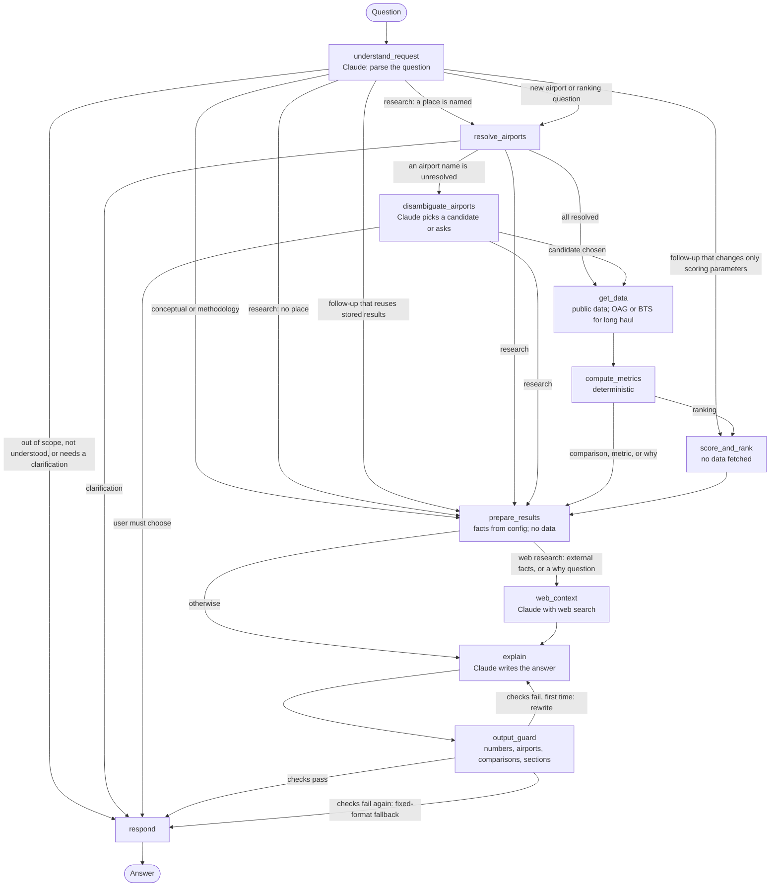

# Airport Investment Intelligence Agent — Design

A chat agent that helps an airport-modernization investor find **US airports where a renovation would be most profitable because of the extra flight and passenger capacity it unlocks**.

Full technical spec: [ARCHITECTURE.md](ARCHITECTURE.md) · Build plan and tests: [PLAN.md](PLAN.md) · How the scoring was chosen: [analysis findings](analysis/FINDINGS_constraint_weights.md)

---

## 1. Approach

A renovation pays off only when **two things are true at once**:
1. **Demand will grow**, so new gates and flights would be used.
2. **The airport is already constrained**: planes are full, the busiest hour is at the ceiling, aircraft queue for the runway or wait for a gate. An airport with spare room can grow without a renovation.

So the agent combines **forecast growth** with **how constrained the airport is today**, and ranks airports by the product. A product, not a sum: growth without constraint, or constraint without growth, scores low, which is how the investment works.

**The core principle:** Claude decides *what* is being asked and *how to say* the answer; **code computes every number**, and a check rejects any number in Claude's answer that code didn't produce.

---

## 2. Scoring methodology — Renovation Profitability Score (RPS)

**RPS = 100 × forecast growth × C** — airports are ranked by RPS, highest first.

| Part | What it is | Source |
|---|---|---|
| **Forecast growth** | Passenger growth over the horizon (default 5 years, from FY2026), relative to the airport's size | **FAA Terminal Area Forecast** — the FAA's official per-airport forecast. Fallback 2%/year where the FAA has no forecast (marked) |
| **C** (0–1) | How constrained the airport is compared with other US airports: the average of 4 signals, each as a **percentile rank** among all US airports | BTS public data, 12 months (passenger counts via the **data.bts.gov API**) |

The four constraint signals:

| Signal | What it shows |
|---|---|
| **Load factor** | Planes are full |
| **Peak saturation** | The normal daily peak hour already reaches the most the airport has handled |
| **Cleaned taxi-out** | Runway queues: taxi-out in busy hours minus quiet hours, same airport (removes airfield size) |
| **Cleaned taxi-in** | **Gate shortage**: planes wait for a gate in busy hours — what a terminal expansion fixes |

**How the method was chosen — from the data, not by assumption** (105 US airports, 6.5M flights):
- **There is no label for "constrained", so we built one** from queueing theory: near capacity, delay rises steeply with each extra flight. Each airport's runway and gate "congestion slope" became the yardstick.
- **13 candidate signals were tested.** NAS delay share and "bigger planes instead of more flights" had **no relation** to congestion and were dropped; the delay rate added nothing once taxi times were cleaned; others duplicated kept signals.
- **Choosing the signals mattered far more than their weights:** equal and regression-derived weights ranked airports almost identically, so equal weights were kept.
- **Percentile rank** beat capped and min–max scaling (no ties, no one airport squeezing the rest). `C` matches measured congestion at **ρ = 0.79** (90% interval 0.72–0.85) — an upper bound, since the cleaned taxi signals share data with the yardstick.
- **Sensitivity:** the busy/quiet cut-offs are safe; the "maximum hour" choice moves mid-table airports, while the **top of a ranking is stable**.

**Every number the method uses is listed with its basis** (official source, published rule, tested on data, or a stated judgment) in [ARCHITECTURE.md §6.9](ARCHITECTURE.md). Numbers nothing could support were removed (see trade-offs).

**What an RPS value means:** an **index for ranking**, not a passenger forecast. It is a **screening index, not a profitability or ROI measure**: the agent has no project cost or revenue data. Each answer also shows the FAA's forecast extra passengers, the drivers, the FAA hub size, and caveats. The measured low/high range covers `C` only; a growth range from past forecast errors is planned.

---

## 3. The agent: LangGraph, 11 nodes

**Scope:** any US airport, state, Census region or division, or the whole country; airports can be ranked by renovation potential (the default) or by any single measure (size, congestion, growth, a signal, delays), highest or lowest first.

**Answer modes:** conceptual explanations (no tools), research with sourced web facts, computed analysis (the tools), methodology, explanation of earlier results, and out-of-scope replies. Each mode has its own output checks: computed answers are checked number by number; web answers are checked against the retrieved text.

**A normal turn:** Claude reads the question → code finds the airports (Claude helps only if a name is ambiguous) → code gets the data and computes the metrics and, for rankings, the score → code builds a **facts bundle** → for "why" questions and external facts, Claude adds web context with its sources → Claude writes the answer → **code checks the answer** against its mode's rules → the answer is sent.

- **Routing is decided by code**, by checking facts in the state — Claude never picks the route.
- **Follow-ups reuse results:** "why is the first one first?" fetches nothing; "use a 10-year horizon" only re-scores.
- **No loops except one `explain` retry.** Data problems never loop: the public data is prepared in advance, and for long haul, if OAG fails or the day doesn't fit the call budget, BTS (domestic only) is used and the answer says so.

---

## 4. Where and how AI is used

| Claude call | Job | Why an LLM | Effort | Guard |
|---|---|---|---|---|
| `understand_request` | Message → structured request (type, airports, region, parameters) | Free phrasing and follow-ups | low | Pydantic schema, enums, 1 retry |
| `disambiguate_airports` | Pick among code-supplied candidates, or ask | Needs geography + conversation | low | Answer must be a listed candidate; the question to the user is written by code |
| `web_context` | Sourced web facts for research questions, background for "why" questions, and facts the tools lack (gates, terminals, a missing metric) | Search and judge sources | low | Every note keeps its source and date; reported as web sources, never as the agent's data; never used in scores or rankings; web text is data, not instructions |
| `explain` | Write the analyst's answer | Clear comparison and caveats | medium | Every number checked against the facts; retry once, then a template answer |

All calls use **Claude Haiku 5.5** through the Anthropic API. The model is a setting (`CLAUDE_MODEL`), so Opus 5.5 or another model is a one-line change. Haiku 5.5 is priced at $0.10 input / $0.50 output per million tokens for prompts up to 100,000 tokens (Anthropic pricing page, checked 2026-11-05). It passed the scope evaluation before the answer-mode rewrite (17 of 17); the rewrite has not been evaluated live. Opus 5.5 was not run on the same evaluation, so no model comparison is claimed. The parsing and disambiguation calls matter most, because a misread is silent, so the disambiguation answer is checked in code and the number check guards every written answer. Effort is set per call.

**Source priority:** for computed answers, BTS, FAA and OAG. Web search serves research questions, background for "why" questions, and gaps the tools cannot fill; its results are labeled with their source and date.

**Deliberately not AI:** airport lookup, regions, data fetching, all metric math, scoring and ranking, clarification questions, the number check and the template answer.

---

## 5. Key trade-offs

| Decision | Chosen | Rejected | Why |
|---|---|---|---|
| Orchestration | Explicit LangGraph graph (11 nodes) | Free tool-calling agent | Predictable, testable per node, guards at fixed points |
| Numbers | Code only | Claude computes | Reproducible and auditable |
| Ranking measure | Growth **relative to size** | Absolute extra passengers | Absolute favors big airports for being big; terminal cost grows with passenger volume. Absolute numbers are still shown |
| Growth source | FAA forecast | Our own trend blend | Official; our blend needed invented weights |
| Turned-away demand | Not counted; load factor in `C` | Spill above a "full" threshold | Public data shows only passengers who flew; the threshold drove the result (31–92 of 105 airports depending on 80–85%) |
| Score | An index | "Passengers unlocked" | That count would need `C` to be a true share of lost demand, which can't be checked |
| Constraint signals | 4, equal weights, percentile rank | More signals; regression weights | Tested: same or better quality, simpler to explain |
| Data sources | OAG for long haul; BTS T-100 via the data.bts.gov API; BTS on-time and FAA forecast as official downloads | OAG for all signals | The OAG key is the free tier (10 records per call): one airport-day costs 49–177 calls. On-time data and the FAA forecast have no API we found |
| Ambiguous airports | Code lists candidates, Claude picks or asks | Claude guesses | No invented airports |

---

## 6. Assumptions and limits

- **Forecasts can be wrong:** growth is the FAA's forecast; the answer cites its edition.
- **Constraint signals are domestic-only** (BTS on-time, reporting airlines). OAG adds international flights for long haul.
- **Gate shortage is measured indirectly**, through planes waiting for a gate; gate counts and terminal data aren't public.
- **Tiny airports** (busiest hour 1–3 flights) can't have a "quiet hour", so their `C` uses two signals instead of four. They stay in the ranking, flagged "2 of 4 ⚑" with an explanation, so a reader can discount them.
- **Relative ranking lifts small fast-growing airports;** each answer shows the FAA hub size and absolute passengers next to the score.
- **FAA growth is planned growth, not unmet demand.** Passengers turned away today can't be counted from public data.
- **Taxi-in is indirect evidence** of gate waiting (busy minus quiet). **Taxi-out queuing does not prove** that an expansion would fix the bottleneck. **Peak throughput is not certified capacity.** The 30-flight minimum is a rule of thumb, not a proof.
- **Same-data validation is not independent:** the congestion check and the signals use the same public data.
- **The number check works by value:** it catches invented numbers, not a real number used in the wrong place.
- **No construction cost data**, so RPS is not an IRR and **not investment advice**.
- **Planned, not built:** the growth part of the range (from older FAA forecasts), a historical backtest, voice, a larger evaluation set.
- **Not checked live:** the answer-mode prompts and the web search on the live model (see PLAN.md §5d).

---

## 7. Results — the four example questions (earlier live run)

These results come from the live run **before** the answer-mode round. They have not been re-run since. Their numbers are computed by code.

| Question | Answer (numbers computed by code) |
|---|---|
| **New England terminal expansion** | **BOS** first (RPS 8.1, range 7.8–8.2), **BTV** second (7.6, 6.9–8.3) — ranges overlap, so the top two are stated as roughly tied; then PWM, ORH, BDL. Over a 10-year horizon BOS's lead becomes clear (16.2 vs 12.3) |
| **LA vs Santa Ana congestion** | "LA" resolved to LAX from context. LAX more constrained (C 0.80) than SNA (C 0.75), both tight by US standards |
| **Anchorage long-haul %** | 20.1% by block time (≥ 6 h), 6.6% by distance (≥ 3,000 mi); passenger flights only: 6.6% / 0.9%. OAG, one schedule day, 441 operating flights |
| **SFO unmet demand and why** | Unmet demand can't be counted from public data. FAA forecast growth +15.2% (4.03M extra passengers, FY2026–FY2031; planned growth, not unmet demand); C 0.70. Cleaned taxi-out +6.9 min, higher than 98% of US airports: a queue indicator, which does not by itself show that a runway project would fix the bottleneck. Gate waiting is average |

Transcripts: [tests/golden/transcripts/](tests/golden/transcripts/). **Tests (run 2026-11-05):** 131 offline tests pass: unit tests, full-graph tests with a scripted Claude, answer-mode tests, held-out cases that appear in no document or prompt, and design-rule tests (no airport names in code; every scoring number has a stated basis). 12 end-to-end tests pass in a browser (Playwright); 1 live end-to-end test is skipped unless `RUN_LIVE_E2E=1` is set. The live test passed in an earlier round, before the answer-mode changes.
